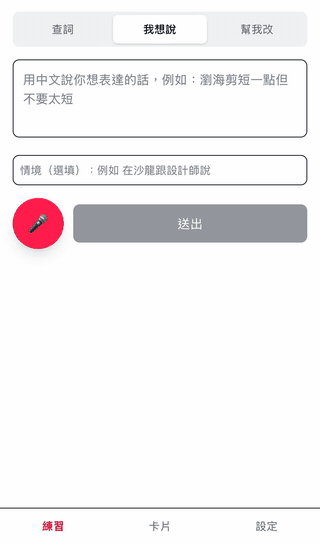
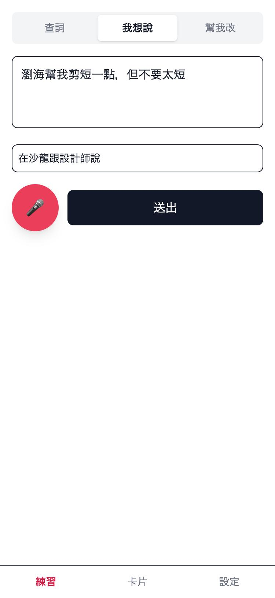
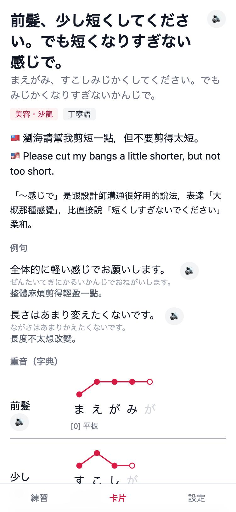
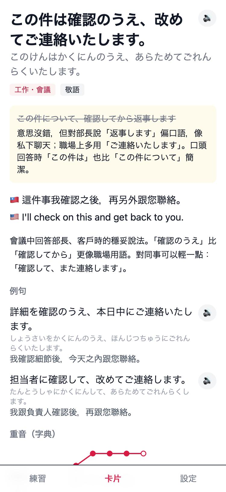
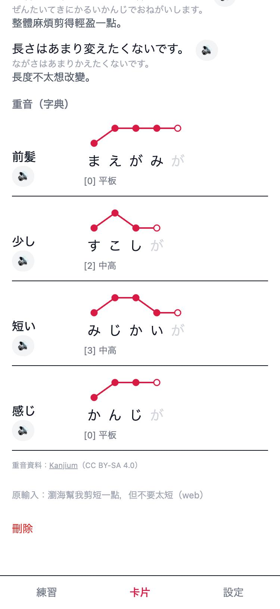
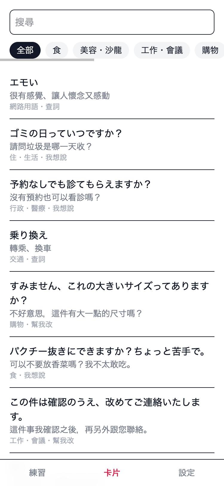
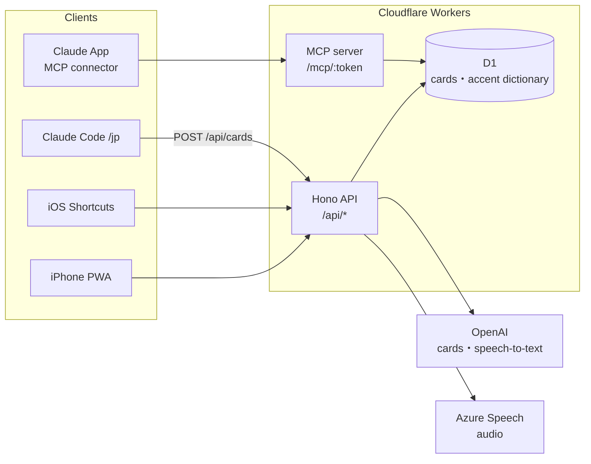

# Nihongo Coach

**English** | [繁體中文](README.zh-TW.md)

A Japanese speaking coach for daily life in Japan. Japanese you don't understand, something you want to say but can't, or something you said that felt off: send it in and it becomes a flashcard you can review later.

- **Look up** (查詞): unfamiliar Japanese → meaning in Chinese and English, nuance, examples, auto category
- **Say it** (我想說): Chinese → natural spoken Japanese
- **Fix it** (幫我改): your Japanese → the natural way to say it, and why the original sounded off

Every card has **dictionary pitch-accent lines** (not guessed by AI) and **Azure neural-voice audio**.

The app UI and explanations are in Traditional Chinese, written for a Taiwanese learner around JLPT N2. The prompt is in [worker/lib/ai.ts](worker/lib/ai.ts) if you want to adapt it.

## Demo

<p align="center">
  
</p>

<p align="center"><sub>Say it: Japanese typed in, the natural version streams in within about a second (15 s, real-time). <a href="docs/images/demo.mp4">MP4 version</a></sub></p>

## Screenshots

> These screenshots use [mock data](scripts/demo-cards.json). Run them yourself with `npm run demo` (see "Demo" below).

<table>
  <tr>
    <td align="center"><br><sub>Practice: pick a mode, type or record</sub></td>
    <td align="center"><br><sub>Say it: Chinese → natural spoken Japanese</sub></td>
    <td align="center"><br><sub>Fix it: what sounded unnatural</sub></td>
  </tr>
  <tr>
    <td align="center"><br><sub>Dictionary pitch accent (heiban / atamadaka / nakadaka / odaka)</sub></td>
    <td align="center"><br><sub>Cards grouped by category, searchable</sub></td>
    <td></td>
  </tr>
</table>

**Highlights**

- **Streams as it writes**: the answer starts appearing about 1 second after you send (OpenAI streaming)
- **Pitch accent is never guessed by AI**: lines are drawn NHK-dictionary style from the [Kanjium](https://github.com/mifunetoshiro/kanjium) accent data (~108k entries)
- **One tap from any app**: an iOS Shortcut in the share sheet looks up selected text or a screenshot (with built-in OCR)
- **Uses your subscription on the computer**: the Claude Code `/jp` skill writes the card and saves it to the app, with no API cost

## Architecture



1. The request's token and shape are checked ([shared/schema.ts](shared/schema.ts) is shared by front end and back end)
2. OpenAI returns JSON in a fixed schema ([worker/lib/ai.ts](worker/lib/ai.ts)); the app renders it over SSE as it arrives
3. The server looks up the card's words in the accent dictionary ([worker/lib/accent.ts](worker/lib/accent.ts)) and adds the pitch lines
4. The card is saved to D1 and returned; `/jp` and MCP send an already-written card, so they start at step 3

## Tech

- Front end: Vite + React + Tailwind, PWA (add to the iPhone home screen)
- Back end: Hono on Cloudflare Workers, D1 (SQLite, Drizzle), R2 (audio cache)
- AI: OpenAI API (one model per mode: `OPENAI_MODEL_LOOKUP`, `OPENAI_MODEL_ZH2JA`, `OPENAI_MODEL_NATURALIZE`, set in `wrangler.jsonc`; `gpt-4o-transcribe` for speech-to-text), Azure Speech (audio)

> A ChatGPT Plus / Pro subscription does **not** include API credits. Add credit under Billing on [platform.openai.com](https://platform.openai.com), then create a key under API keys.

## Local development

```bash
npm install
cp .dev.vars.example .dev.vars   # add your API keys and an APP_TOKEN of your choice
npm run db:migrate:local
npm run dev
```

Open http://localhost:5173 and enter your `APP_TOKEN` the first time.

### Import the accent dictionary

Download `data/source_files/raw/accents.txt` from [Kanjium](https://github.com/mifunetoshiro/kanjium) to `data/kanjium/accents.txt` (~108k entries):

```bash
curl -L -o data/kanjium/accents.txt https://raw.githubusercontent.com/mifunetoshiro/kanjium/master/data/source_files/raw/accents.txt
node scripts/import-accents.ts data/kanjium/accents.txt > data/kanjium/accents.sql
npx wrangler d1 execute nihongo-coach --local --file data/kanjium/accents.sql
```

Without it the app still works; the accent section just says the word isn't in the dictionary. Card pages look the dictionary up again each time they open, so cards made before the import get accents too.

The accent data comes from Kanjium under [CC BY-SA 4.0](https://creativecommons.org/licenses/by-sa/4.0/), credited in the app.

### Demo (mock data)

See the UI without any API key: a separate local database with the sample cards from [scripts/demo-cards.json](scripts/demo-cards.json). Download the accent dictionary first (previous section) and set `APP_TOKEN` in `.dev.vars`.

```bash
npm run demo:setup          # create the demo database and import the accent dictionary
npm run demo                # http://localhost:5174
node scripts/seed-demo.ts   # in another terminal: add the sample cards
```

## Deploy

```bash
cp .prod.vars.example .prod.vars             # note your URL and tokens (git-ignored)
npx wrangler login
npx wrangler d1 create nihongo-coach          # paste the database_id into wrangler.jsonc
npm run db:migrate:remote
npx wrangler d1 execute nihongo-coach --remote --file data/kanjium/accents.sql
npx wrangler secret put APP_TOKEN
npx wrangler secret put OPENAI_API_KEY
npx wrangler secret put AZURE_SPEECH_KEY
npm run deploy
```

> ⚠️ Importing the accent dictionary remotely writes about 320k rows (108k entries plus indexes), more than the free plan's 100k rows written per day. The import itself completes, but further writes (saving cards) are blocked until 00:00 UTC the next day. You only import once; after that each card writes just a few rows.

R2 (audio cache) is optional: enable R2 in the Cloudflare dashboard, run `npx wrangler r2 bucket create nihongo-coach-audio`, uncomment `r2_buckets` in `wrangler.jsonc`, and deploy again.

> After you change `database_id`, local dev uses a new empty database; run `npm run db:migrate:local` and the accent import again.

On the iPhone, open the deployed URL in Safari → Share → Add to Home Screen. Then set up the shortcuts in [docs/ios-shortcuts.md](docs/ios-shortcuts.md) (written in Chinese).

## Use your subscription on the computer: the `/jp` skill

In Claude Code, the `/jp` skill makes cards on your subscription instead of the API. They are saved to the app like any other card and show up on the phone.

```bash
ln -s "$PWD/skills/jp" ~/.claude/skills/jp   # install once; works in every project
```

In any Claude Code conversation:

```
/jp 說 可以幫我把後面打薄一點嗎 @在沙龍跟設計師說
/jp 改 この件について確認してから返事します @會議中回答部長
/jp 查 推し活
```

`說` is Say it, `改` is Fix it, and `查` is Look up; without one, the mode is picked automatically. Text after `@` is the situation. The skill reads the prompt in `worker/lib/ai.ts` and the schema in `shared/schema.ts`, so it follows the same rules as the app. The URL and token come from `.prod.vars`, and the token is never printed.

## Claude mobile app: MCP connector

The Worker serves an MCP server at `/mcp/<MCP_TOKEN>` (Streamable HTTP, stateless) with two tools:

- `save_card`: Claude writes the card following the app's rules and saves it; the server adds accents (source `claude-app`)
- `list_cards`: reads recently saved cards, optionally filtered by category or text

claude.ai custom connectors only take a URL, so the secret lives in the path; any wrong URL returns 404.

Setup (once):

1. `npx wrangler secret put MCP_TOKEN` (keep the full URL as `MCP_URL` in `.prod.vars`)
2. On **claude.ai on the web** → Settings → Connectors → Add custom connector, name it `Nihongo Coach` and paste `MCP_URL`. You can't add connectors in the mobile app, but once added on the web they work there too. On Team and Enterprise plans, only an Owner can add custom connectors.
3. In the Claude mobile app, just ask, for example "How do I say this in Japanese: …", "Fix my Japanese: …", or "Look up: 諸々", and Claude calls `save_card`.

Test it with [MCP Inspector](https://github.com/modelcontextprotocol/inspector):

```bash
npx @modelcontextprotocol/inspector --cli "$MCP_URL" --transport http --method tools/list
```

## API

Every route needs `Authorization: Bearer <APP_TOKEN>`.

| Method | Path | Description |
|---|---|---|
| POST | `/api/ask` | `{ mode, text, context?, source? }` → card; `?format=text` returns plain text (for Shortcuts); `?stream=1` streams over SSE |
| GET | `/api/cards?category=&q=` | List cards |
| POST | `/api/cards` | `{ mode, input, source?, draft }` saves an already-written card without calling the AI (used by `/jp`); also supports `?format=text` |
| GET / DELETE | `/api/cards/:id` | One card |
| POST | `/api/transcribe` | multipart `audio` → `{ text }` |
| POST | `/api/tts` | `{ text }` → mp3 |

## Next (Phase 2 / 3)

- Situation packs (salon, doctor's visit, …) with a quick review before you go
- Spaced-repetition speaking review (`cards` already has FSRS columns)
- Record yourself → compare your pitch curve with the reference audio
- Live meeting transcription (Mac tab audio / iPhone mic)

## License

The code is under the [MIT License](LICENSE). The accent dictionary data comes from [Kanjium](https://github.com/mifunetoshiro/kanjium) under CC BY-SA 4.0; it is not included in this repo and must be downloaded separately.
