# Nihongo Coach

**English** | [繁體中文](README.zh-TW.md)

A Japanese speaking coach for daily life in Japan. Japanese you don't understand, something you want to say but can't, or something you said that felt off: send it in and it becomes a flashcard. Then practise speaking with drills, reading passages and spoken review.

**Version 0.4.0** · [Changelog](CHANGELOG.md) · [How releases work](docs/RELEASING.md)

The app UI and explanations are in Traditional Chinese, written for a Taiwanese front-end engineer around JLPT N1. The prompts are in [worker/lib/ai.ts](worker/lib/ai.ts) if you want to adapt them.

## The app in one minute

The app is an iPhone PWA with four tabs. Settings (your token, new cards per day) are in the ☰ menu at the top right.

| Tab | What you do there |
|---|---|
| **查詢** (Ask) | Type or say something in one of three modes. Each answer is saved as a card. **查詞** (Look up): unfamiliar Japanese → meaning, nuance, examples. **我想說** (Say it): Chinese → natural spoken Japanese. **幫我改** (Fix it): your Japanese → the natural way to say it, and why. |
| **練習** (Practice) | Two sub-tabs. **會話** (Conversation): short work and daily-life role-plays you answer in Japanese, corrected as you go. **讀音** (Reading): read a kanji passage aloud without furigana, then reveal the readings and mark the words you misread. |
| **複習** (Review) | Spaced-repetition review for *speaking*: see the prompt, say the Japanese out loud, then reveal the card and rate yourself. |
| **卡片** (Cards) | All your cards by category, searchable. Every card has dictionary pitch-accent lines (not guessed by AI), neural-voice audio, and **🎙 錄音比對** to compare your own pitch with the dictionary. |

Cards also come in from outside the app: an **iOS Shortcut** in the share sheet, the **`/jp` skill** in Claude Code, and an **MCP connector** for the Claude apps.

## Demo

<p align="center">
  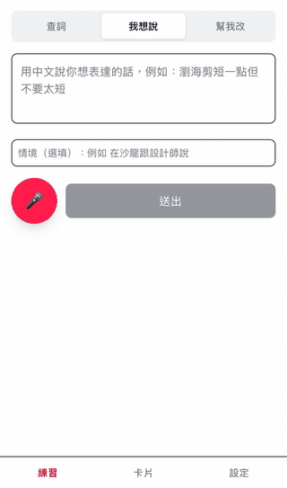
</p>

<p align="center"><sub>Say it: Japanese typed in, the natural version streams in within about a second (15 s, real-time). <a href="docs/images/demo.mp4">MP4 version</a></sub></p>

## Screenshots

> These screenshots use [mock data](scripts/demo-cards.json) and demo mode. Run it yourself with `npm run demo` (see [Demo](#demo-mock-data) below).

<table>
  <tr>
    <th colspan="4" align="left">查詢 (Ask) and 卡片 (Cards)</th>
  </tr>
  <tr>
    <td align="center" width="25%">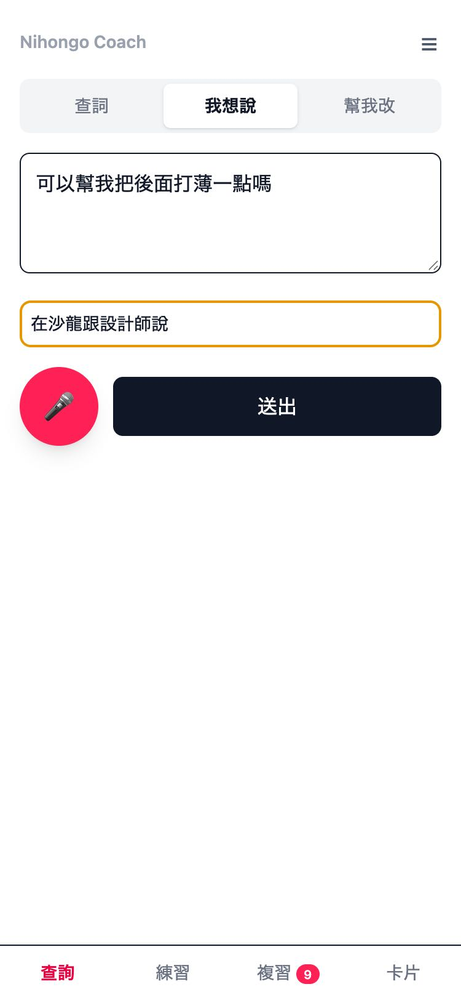<br><sub>Pick a mode, type or record</sub></td>
    <td align="center" width="25%">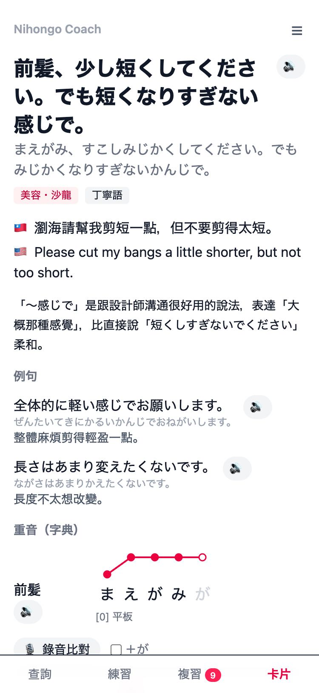<br><sub>Say it: Chinese → natural Japanese</sub></td>
    <td align="center" width="25%">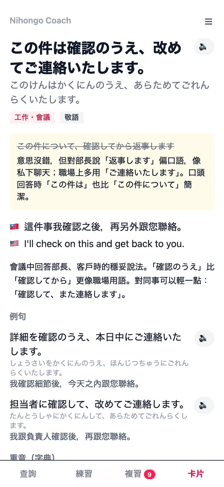<br><sub>Fix it: what sounded off, and why</sub></td>
    <td align="center" width="25%">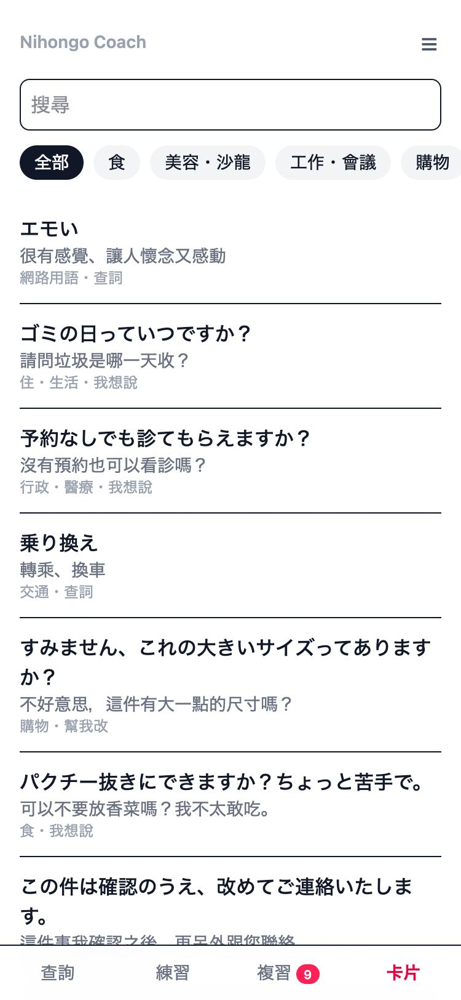<br><sub>Cards by category, searchable</sub></td>
  </tr>
  <tr>
    <th colspan="4" align="left">練習 (Practice): 會話 and 讀音</th>
  </tr>
  <tr>
    <td align="center">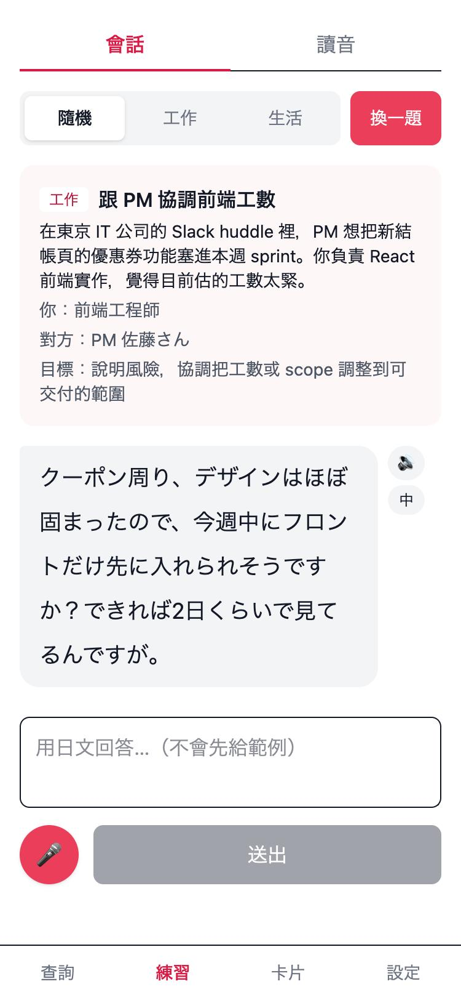<br><sub>會話: a scene, no model answer</sub></td>
    <td align="center">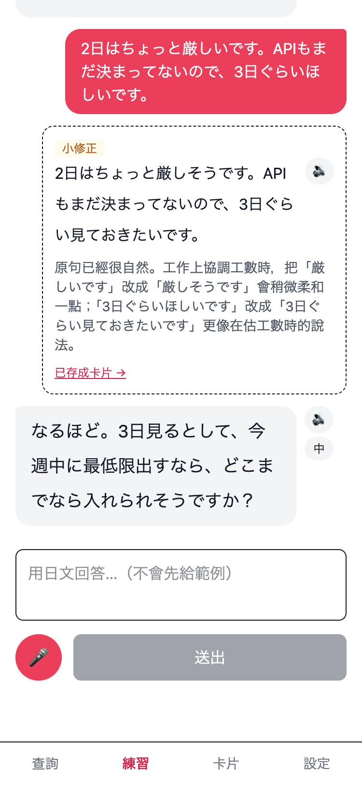<br><sub>會話: correction and note</sub></td>
    <td align="center">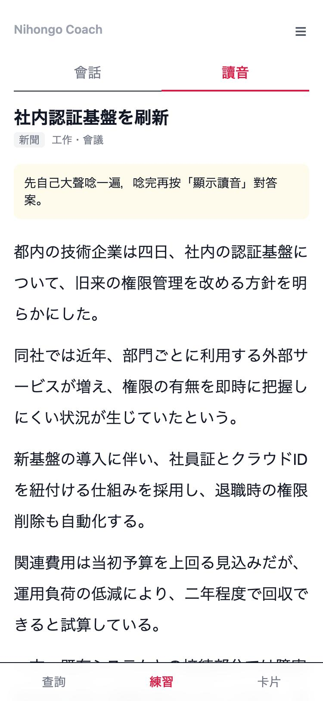<br><sub>讀音: read it aloud first</sub></td>
    <td align="center">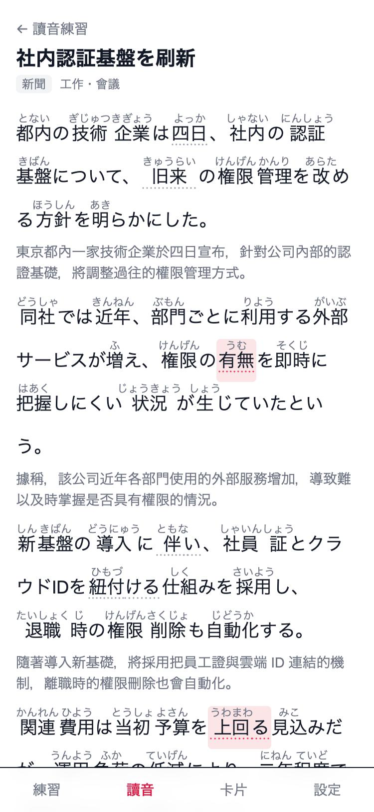<br><sub>讀音: reveal, mark misread words</sub></td>
  </tr>
  <tr>
    <th colspan="4" align="left">複習 (Review) and pitch accent</th>
  </tr>
  <tr>
    <td align="center">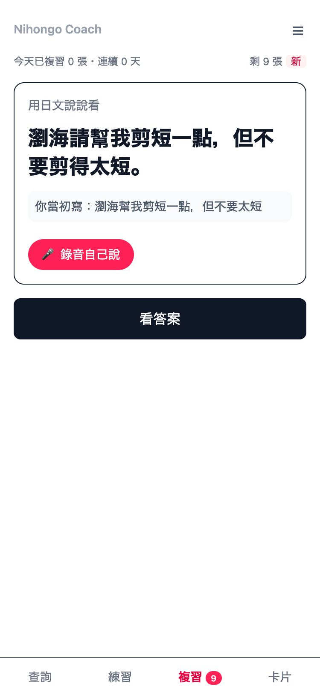<br><sub>複習: say it before you look</sub></td>
    <td align="center">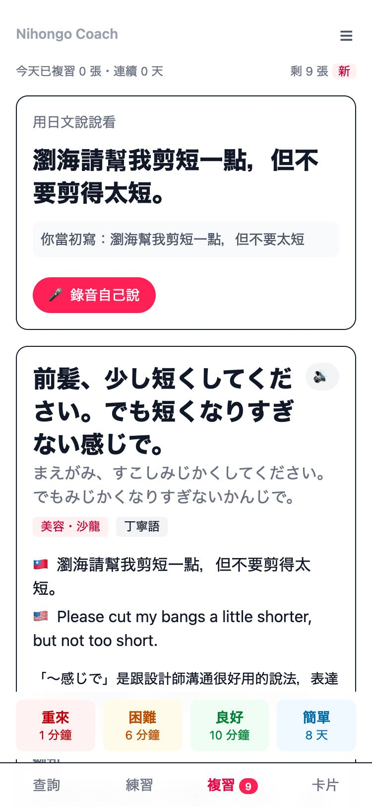<br><sub>複習: check, then rate</sub></td>
    <td align="center">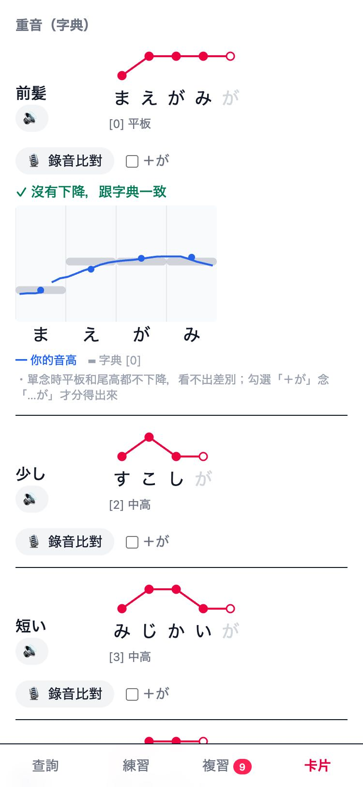<br><sub>🎙 錄音比對: your pitch vs. the dictionary</sub></td>
    <td></td>
  </tr>
</table>

## Features

### 查詢 (Ask): make a card

- **Streams as it writes**: the answer starts appearing about 1 second after you send (OpenAI streaming).
- **Voice or text**: tap the mic to speak instead of typing (`gpt-4o-transcribe`). Add an optional situation (「在沙龍跟設計師說」) for a better register.
- **Auto category**: cards are filed as 食, 工作・會議, 美容・沙龍, … and searchable in 卡片.

### 練習 → 會話 (Conversation practice)

Each drill opens with a scene, your role, and the other person's first line, with no model answer: you reply in Japanese, by typing or with the mic.

- After each reply you get a natural version that keeps what you meant, readings on hard words, and a short note in Traditional Chinese on what changed. Then the other person answers and the conversation moves on.
- About 3–4 exchanges, then a short wrap-up with expressions to remember.
- **＋ 存成卡片** turns a correction into a regular Fix it card (source `practice`), with pitch accents, so it shows up in your cards and in review.
- Scenes mix work (progress reports, spec questions, review requests, priorities, release talks, failing E2E tests, …) and daily life (shopping, restaurants, housing, hobbies, …), about 4 work to 3 life a week. Themes rotate, and recent drills are passed to the prompt to avoid repeats. Pick 工作 or 生活 to choose yourself.

Prompts are in [worker/lib/practice.ts](worker/lib/practice.ts); the model is `OPENAI_MODEL_PRACTICE` in `wrangler.jsonc`.

### 練習 → 讀音 (Kanji reading practice)

A short passage, alternating between a dialogue (對話) and a news-style report (新聞), set at work (meetings, releases, specs) or in daily Tokyo life. It is written for an N1-level reader and packed with words that are easy to misread (on/kun choice, rendaku, irregular readings like 重複, 相殺, 早急).

1. Read it aloud with no furigana. You can record yourself and play it back; the audio stays on the phone.
2. Tap **顯示讀音** (show readings): every kanji word gets furigana, each sentence gets a Chinese translation, and the tricky words are listed with reading, meaning, and why they're misread. 🔊 plays each sentence and each tricky word with the reading pinned, so 重複 is never read じゅうふく.
3. Tap the words you got wrong, in the passage or the list, and save them as cards in one tap (source `reading`, with the passage sentence as an example and dictionary pitch accent).

Recent topics and words are kept in D1 so the next passage doesn't repeat them. Speech-to-text isn't used to grade, because it writes kanji back and can't tell how you read them.

### 複習 (Speaking review, SRS)

Spaced-repetition review for speaking, not recognition. Each card shows a prompt and you say the Japanese out loud before revealing the answer:

- **Say it / Fix it** cards show the Chinese meaning (and what you originally wrote); you say the natural Japanese.
- **Look up** cards show the Japanese word; you explain its meaning and use it in a sentence.

Optionally tap 🎤 錄音自己說 to record yourself and play it back (stays on the device). Then reveal the full card and rate yourself 重來 / 困難 / 良好 / 簡單 (Again / Hard / Good / Easy); each button shows when the card will come back. Scheduling uses [FSRS](https://github.com/open-spaced-repetition/ts-fsrs), and every review is logged in `review_logs`.

Every saved card (app, `/jp`, MCP) joins the queue automatically. Due cards come first, then up to 20 new cards a day (change it in ☰ → 設定). The tab badge shows how many are left today, and the page shows today's count and your streak.

### 卡片 (Cards): pitch accent and 🎙 錄音比對

- **Pitch accent is never guessed by AI**: lines are drawn NHK-dictionary style from the [Kanjium](https://github.com/mifunetoshiro/kanjium) accent data (~108k entries).
- **Check your own pitch accent**: tap 🎙 錄音比對 on a word in the accent section, say it, and see your pitch curve over the dictionary pattern with a verdict on where the fall should be. Tick **＋が** to say it with が, which is how you tell heiban from odaka. Analysed on the device, never uploaded ([src/lib/pitch.ts](src/lib/pitch.ts); `node scripts/check-pitch.ts` runs the checks on synthetic voices).
- **Neural-voice audio** on the sentence, every example and every word (Azure Speech). A word is sent with its reading, and the server pins the reading and the Kanjium accent with SSML (`<phoneme>`), because a lone kanji is often read wrong (端 → たん, 命 → めい). Each clip is synthesized once: cached in R2 if you enable it, otherwise in the Workers Cache API. Why Azure and not Gemini, and how the accent is pinned: [docs/tts.md](docs/tts.md).

### Other ways in

- **One tap from any app**: an iOS Shortcut in the share sheet looks up selected text or a screenshot (with built-in OCR). See [docs/ios-shortcuts.md](docs/ios-shortcuts.md).
- **Uses your subscription on the computer**: the Claude Code [`/jp` skill](#use-your-subscription-on-the-computer-the-jp-skill) writes the card and saves it to the app, with no API cost.
- **Claude mobile app**: an [MCP connector](#claude-mobile-app-mcp-connector) lets Claude save cards from any conversation.

## Architecture

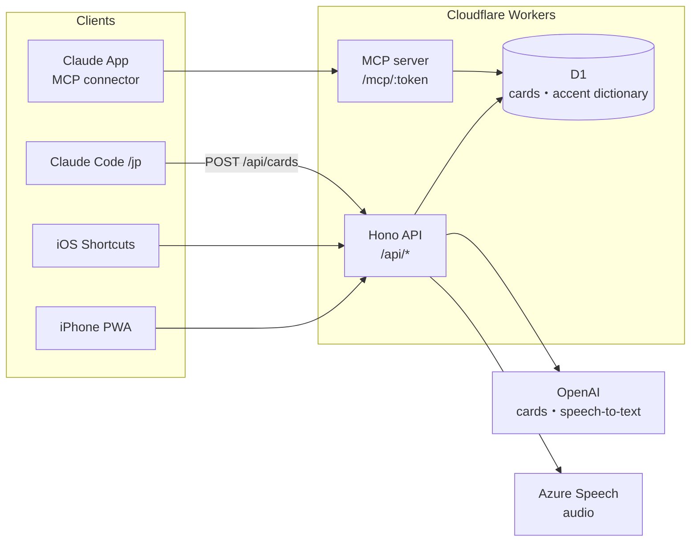

1. The request's token and shape are checked ([shared/schema.ts](shared/schema.ts) is shared by front end and back end)
2. OpenAI returns JSON in a fixed schema ([worker/lib/ai.ts](worker/lib/ai.ts)); the app renders it over SSE as it arrives
3. The server looks up the card's words in the accent dictionary ([worker/lib/accent.ts](worker/lib/accent.ts)) and adds the pitch lines
4. The card is saved to D1 and returned; `/jp` and MCP send an already-written card, so they start at step 3

## Tech

- Front end: Vite + React + Tailwind, PWA (add to the iPhone home screen)
- Back end: Hono on Cloudflare Workers, D1 (SQLite, Drizzle), R2 (audio cache)
- AI: OpenAI API (one model per mode: `OPENAI_MODEL_LOOKUP`, `OPENAI_MODEL_ZH2JA`, `OPENAI_MODEL_NATURALIZE`, plus `OPENAI_MODEL_PRACTICE` for conversation drills and `OPENAI_MODEL_READING` for reading passages, set in `wrangler.jsonc`; `gpt-4o-transcribe` for speech-to-text), Azure Speech (audio)

> A ChatGPT Plus / Pro subscription does **not** include API credits. Add credit under Billing on [platform.openai.com](https://platform.openai.com), then create a key under API keys.

## Local development

```bash
npm install
cp .dev.vars.example .dev.vars   # add your API keys and an APP_TOKEN of your choice
npm run db:migrate:local
npm run dev
```

Open http://localhost:5173 and enter your `APP_TOKEN` the first time. To change it later, open ☰ (top right) → 設定.

### Import the accent dictionary

Download `data/source_files/raw/accents.txt` from [Kanjium](https://github.com/mifunetoshiro/kanjium) to `data/kanjium/accents.txt` (~108k entries):

```bash
curl -L -o data/kanjium/accents.txt https://raw.githubusercontent.com/mifunetoshiro/kanjium/master/data/source_files/raw/accents.txt
node scripts/import-accents.ts data/kanjium/accents.txt > data/kanjium/accents.sql
npx wrangler d1 execute nihongo-coach --local --file data/kanjium/accents.sql
```

Without it the app still works; the accent section just says the word isn't in the dictionary. Card pages look the dictionary up again each time they open, so cards made before the import get accents too.

The accent data comes from Kanjium under [CC BY-SA 4.0](https://creativecommons.org/licenses/by-sa/4.0/), credited in the app.

### Demo (mock data)

See the UI without any API key: a separate local database with the sample cards from [scripts/demo-cards.json](scripts/demo-cards.json). Download the accent dictionary first (previous section) and set `APP_TOKEN` in `.dev.vars`.

```bash
npm run demo:setup          # create the demo database and import the accent dictionary
npm run demo                # http://localhost:5174
node scripts/seed-demo.ts   # in another terminal: add the sample cards
```

## Deploy

```bash
cp .prod.vars.example .prod.vars             # note your URL and tokens (git-ignored)
npx wrangler login
npx wrangler d1 create nihongo-coach          # paste the database_id into wrangler.jsonc
npm run db:migrate:remote
npx wrangler d1 execute nihongo-coach --remote --file data/kanjium/accents.sql
npx wrangler secret put APP_TOKEN
npx wrangler secret put OPENAI_API_KEY
npx wrangler secret put AZURE_SPEECH_KEY
npm run deploy
```

> ⚠️ Importing the accent dictionary remotely writes about 320k rows (108k entries plus indexes), more than the free plan's 100k rows written per day. The import itself completes, but further writes (saving cards) are blocked until 00:00 UTC the next day. You only import once; after that each card writes just a few rows.

`AZURE_SPEECH_KEY` comes from an Azure **Speech service** resource (Free F0 gives 500k neural characters a month; region must match `AZURE_SPEECH_REGION`, `japaneast` by default). Without it `/api/tts` answers 501 and the app uses the browser voice.

R2 (audio cache) is optional: enable R2 in the Cloudflare dashboard, run `npx wrangler r2 bucket create nihongo-coach-audio`, uncomment `r2_buckets` in `wrangler.jsonc`, and deploy again. Without R2, audio is cached with the Workers Cache API, which works on `*.workers.dev` too but is per data centre and can be evicted.

> After you change `database_id`, local dev uses a new empty database; run `npm run db:migrate:local` and the accent import again.

After the first deploy, releases are automated: `npm run release -- minor` tags a version, and a GitHub Actions workflow applies the D1 migrations and deploys it after you approve. [docs/RELEASING.md](docs/RELEASING.md) has the one-time GitHub and Cloudflare setup, backups and rollback. What it costs to run, the free-tier limits and how to cap spending: [docs/COSTS.md](docs/COSTS.md).

On the iPhone, open the deployed URL in Safari → Share → Add to Home Screen. Then set up the shortcuts in [docs/ios-shortcuts.md](docs/ios-shortcuts.md) (written in Chinese).

## Use your subscription on the computer: the `/jp` skill

In Claude Code or Codex, the `/jp` skill makes cards on your subscription instead of the API. They are saved to the app like any other card and show up on the phone.

```bash
ln -s "$PWD/skills/jp" ~/.claude/skills/jp   # Claude Code: install once; works in every project
```

```bash
ln -s "$PWD/skills/jp" ~/.agents/skills/jp   # Codex (CLI and the ChatGPT desktop app): same file
```

In Codex, call it as `$jp` instead of `/jp`. The first `curl` needs network access: approve it when Codex asks.

In any Claude Code conversation:

```
/jp 說 可以幫我把後面打薄一點嗎 @在沙龍跟設計師說
/jp 改 この件について確認してから返事します @會議中回答部長
/jp 查 推し活
```

`說` is Say it, `改` is Fix it, and `查` is Look up; without one, the mode is picked automatically. Text after `@` is the situation. The skill reads the prompt in `worker/lib/ai.ts` and the schema in `shared/schema.ts`, so it follows the same rules as the app. The URL and token come from `.prod.vars`, and the token is never printed. Cards are tagged with source `claude-code` or `codex`.

## Claude mobile app: MCP connector

The Worker serves an MCP server at `/mcp/<MCP_TOKEN>` (Streamable HTTP, stateless) with two tools:

- `save_card`: Claude writes the card following the app's rules and saves it; the server adds accents (source `claude-app`, or `chatgpt` with `?source=chatgpt`)
- `list_cards`: reads recently saved cards, optionally filtered by category or text

claude.ai custom connectors only take a URL, so the secret lives in the path; any wrong URL returns 404.

Setup (once):

1. `npx wrangler secret put MCP_TOKEN` (keep the full URL as `MCP_URL` in `.prod.vars`)
2. On **claude.ai on the web** → Settings → Connectors → Add custom connector, name it `Nihongo Coach` and paste `MCP_URL`. You can't add connectors in the mobile app, but once added on the web they work there too. On Team and Enterprise plans, only an Owner can add custom connectors.
3. In the Claude mobile app, just ask, for example "How do I say this in Japanese: …", "Fix my Japanese: …", or "Look up: 諸々", and Claude calls `save_card`.

Test it with [MCP Inspector](https://github.com/modelcontextprotocol/inspector):

```bash
npx @modelcontextprotocol/inspector --cli "$MCP_URL" --transport http --method tools/list
```

## ChatGPT: voice practice and saving cards

On a personal ChatGPT plan (Plus or Pro), ChatGPT can't call a custom MCP server that writes data, and custom GPTs retire on 2026-12-11. So the setup has two parts:

- A **ChatGPT Project** with [integrations/chatgpt/project-instructions.md](integrations/chatgpt/project-instructions.md) as its instructions, for spoken drills in voice mode. It follows the app's 會話練習 rules and never judges pitch accent.
- A private **ChatGPT Site** that hosts a small MCP proxy to `/mcp/<MCP_TOKEN>?source=chatgpt`, which ChatGPT turns into a personal plugin. Its build prompt is [integrations/chatgpt/site-prompt.md](integrations/chatgpt/site-prompt.md). `MCP_URL` is stored as a Site secret, not in the repo.

After a drill, send 「存卡」 in a text chat and the corrections are saved as cards with source `chatgpt`. Step-by-step setup (in Chinese): [integrations/chatgpt/README.md](integrations/chatgpt/README.md).

## API

Every route needs `Authorization: Bearer <APP_TOKEN>`.

| Method | Path | Description |
|---|---|---|
| POST | `/api/ask` | `{ mode, text, context?, source? }` → card; `?format=text` returns plain text (for Shortcuts); `?stream=1` streams over SSE |
| GET | `/api/cards?category=&q=&cursor=&limit=` | List cards, newest first: `{ cards, nextCursor }`. Pass `nextCursor` back as `cursor` for the next page (`null` on the last page); `limit` defaults to 30, max 100 |
| POST | `/api/cards` | `{ mode, input, source?, draft }` saves an already-written card without calling the AI (used by `/jp`); also supports `?format=text` |
| GET / DELETE | `/api/cards/:id` | One card |
| GET | `/api/practice?limit=` | Recent conversation drills |
| POST | `/api/practice` | `{ kind?: "work" \| "life" }` → starts a drill; streams over SSE, ending with a `session` event |
| GET | `/api/practice/:id` | One drill with its turns |
| POST | `/api/practice/:id/turns` | `{ text }` → correction and the next line; streams over SSE, ending with a `turn` event |
| POST | `/api/practice/turns/:id/card` | Saves that turn's correction as a card |
| POST | `/api/transcribe` | multipart `audio` → `{ text }` |
| POST | `/api/tts` | `{ text, reading?, parts? }` → mp3. `reading` (one word) pins reading and dictionary accent; `parts` (`[{ text, reading }]`, a sentence's tokens) pins readings. 501 when `AZURE_SPEECH_KEY` is not set |
| GET / POST | `/api/reading` | Recent reading passages / `{ kind? }` (`conversation` or `news`; alternates when omitted) → a new passage |
| GET | `/api/reading/:id` | One passage |
| POST | `/api/reading/:id/cards` | `{ words }` (indexes into the passage's `words`) → saves the misread words as cards |
| GET | `/api/review/queue?tz=&new=` | Today's review queue: `{ cards, stats }`, due cards first, then new cards. `tz` is the client's UTC offset in minutes (for "today"); `new` is new cards per day (default 20). Each card has `intervals` (ms until due again for ratings 1–4) |
| GET | `/api/review/count?tz=&new=` | `{ due, new, reviewedToday, streak }` |
| POST | `/api/review/:id?tz=&new=` | `{ rating: 1 \| 2 \| 3 \| 4 }` (Again / Hard / Good / Easy) reschedules the card; returns the updated stats |

## Next (Phase 2 / 3)

- Situation packs (salon, doctor's visit, …) with a quick review before you go
- Overlay the reference audio's pitch curve on your recording (needs Azure TTS)
- Live meeting transcription (Mac tab audio / iPhone mic)

## Version history

Releases are listed in [CHANGELOG.md](CHANGELOG.md): 0.1.0 (Phase 1 MVP), 0.2.0 (streaming, `/jp`, MCP, demo mode, public release), 0.3.0 (practice, reading, review, pitch recording). [docs/RELEASING.md](docs/RELEASING.md) describes the release flow: CI on every PR, `npm run release`, and the tag-triggered deploy with D1 migrations.

## License

The code is under the [MIT License](LICENSE). The accent dictionary data comes from [Kanjium](https://github.com/mifunetoshiro/kanjium) under CC BY-SA 4.0; it is not included in this repo and must be downloaded separately.
