# Nihongo Coach

[English](README.md) | **繁體中文**

在日本生活用的日文口說助手。看到不懂的日文、想說卻不會說、說了覺得怪，都丟進來，結果會存成一張卡片，之後可以複習。

- **查詞**：看到不懂的日文 → 中文、英文、語感、例句、自動分類
- **我想說**：說中文 → 自然的口語日文
- **幫我改**：說日文 → 自然講法 + 為什麼原本怪怪的
- **會話練習**：工作與生活的短情境對話，用日文回答，邊聊邊幫你改
- **讀音練習**：不看假名唸一段短文，再對讀音，把唸錯的字存成卡片

每張卡都附 **字典重音高低線**（不是 AI 猜的）和 **Azure 神經語音示範音**。

## 示範影片

<p align="center">
  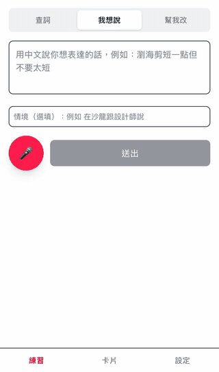
</p>

<p align="center"><sub>輸入句子後約 1 秒開始出現答案，卡片邊產生邊顯示（15 秒，實際速度）。<a href="docs/images/demo.mp4">MP4 版本</a></sub></p>

## 畫面

> 以下截圖使用 [mock 資料](scripts/demo-cards.json)，可以用 `npm run demo` 自己跑起來看（見下方「Demo」）。

<table>
  <tr>
    <td align="center">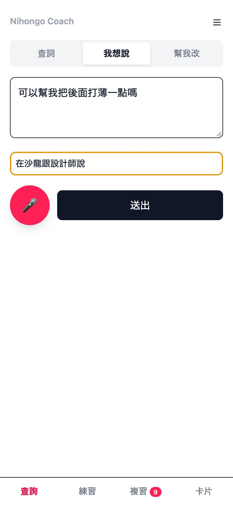<br><sub>查詢：選模式、打字或錄音</sub></td>
    <td align="center">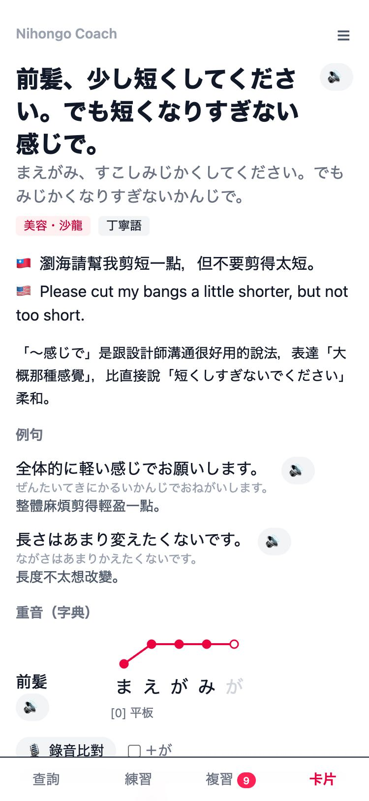<br><sub>我想說：中文 → 自然口語日文</sub></td>
    <td align="center">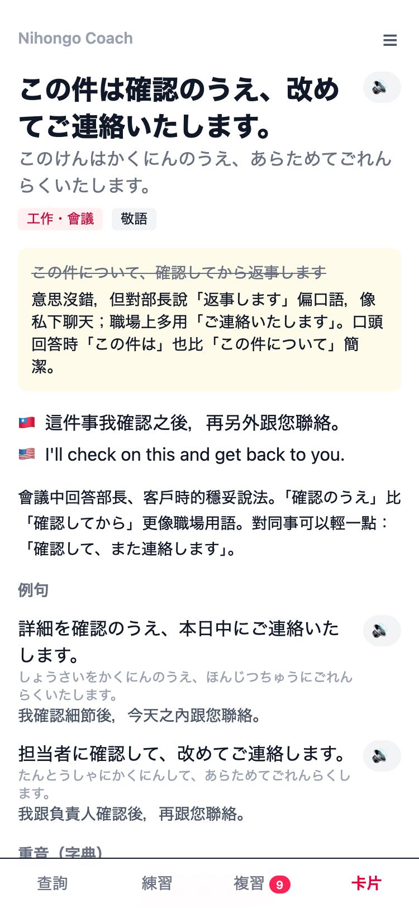<br><sub>幫我改：原句哪裡不自然</sub></td>
  </tr>
  <tr>
    <td align="center">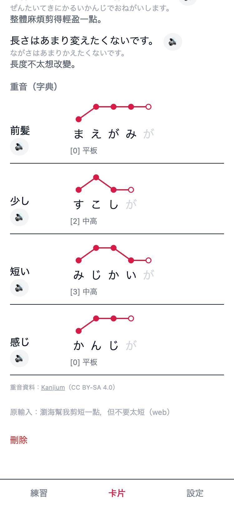<br><sub>字典重音高低線（平板／頭高／中高／尾高）</sub></td>
    <td align="center">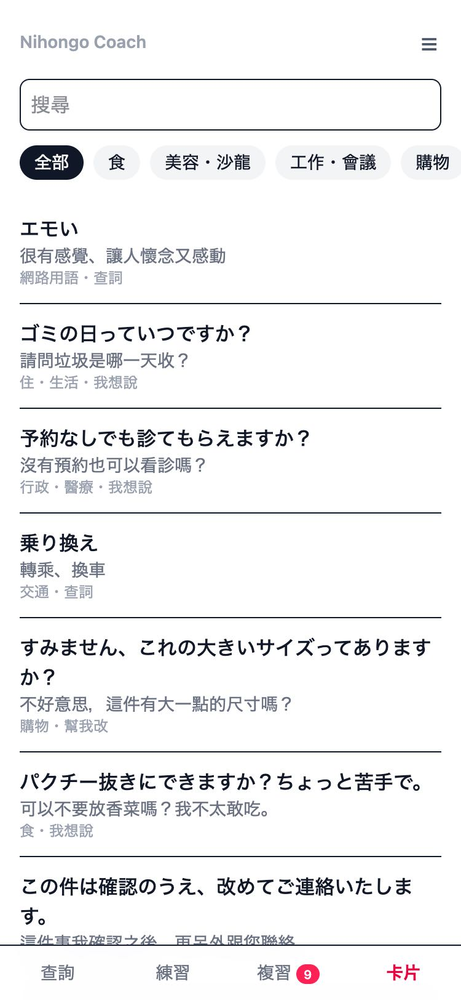<br><sub>卡片依分類整理、可搜尋</sub></td>
    <td></td>
  </tr>
</table>

**亮點**

- **邊產生邊顯示**：送出後約 1 秒就開始出現答案（OpenAI 串流）
- **重音不靠 AI 猜**：用 [Kanjium](https://github.com/mifunetoshiro/kanjium) 重音字典（約 10.8 萬筆）畫出 NHK 辭典式的高低線
- **從任何 App 一鍵查詞**：iOS 捷徑放進分享選單，選取文字或截圖（自動 OCR）就能查
- **電腦上走訂閱額度**：Claude Code 的 `/jp` skill 直接寫卡片存進 App，不花 API 費用

## 會話練習

「練習」分頁上方可以切換「會話」和「讀音」（見下一節）。「會話」是短的口說練習。每題先給情境、你的角色和對方的第一句話，不會先給範例答案：你用日文回答，可以打字或按麥克風。

- 每次回答後會給一個保留你原意的自然說法、難字標上讀音，並用繁體中文簡短說明改了什麼。接著對方回話，對話繼續。
- 大約 3–4 來回，最後簡短總結，附上值得記的說法。
- 按 **＋ 存成卡片** 會把修正存成一般的「幫我改」卡片（source `practice`），附重音，之後會出現在卡片列表與複習裡。
- 情境混合工作（進度報告、確認規格、請人 review、排優先順序、上線討論、E2E 測試掛掉…）與生活（購物、餐廳、住處、興趣…），一週大約 4 工作 3 生活。主題會輪替，最近練過的題目會帶進 prompt 避免重複；也可以自己選「工作」或「生活」。

<table>
  <tr>
    <td align="center">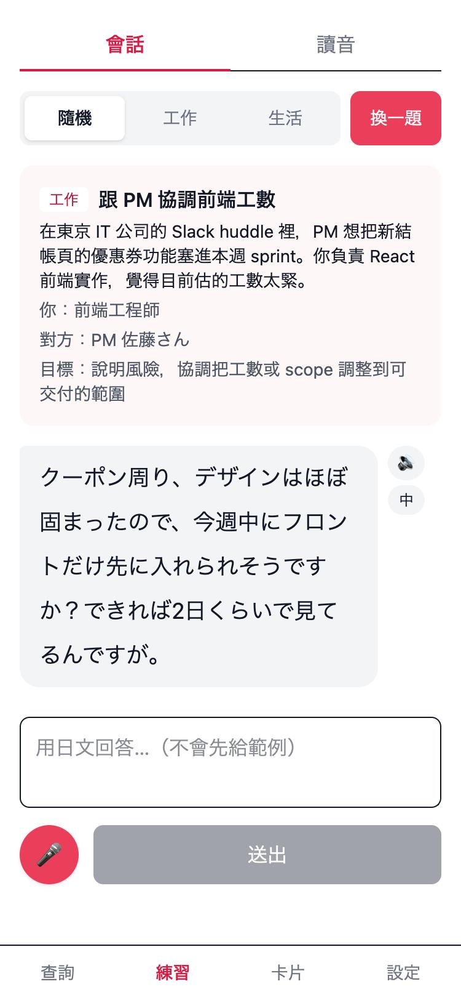<br><sub>工作情境：不先給範例，直接用日文回答</sub></td>
    <td align="center">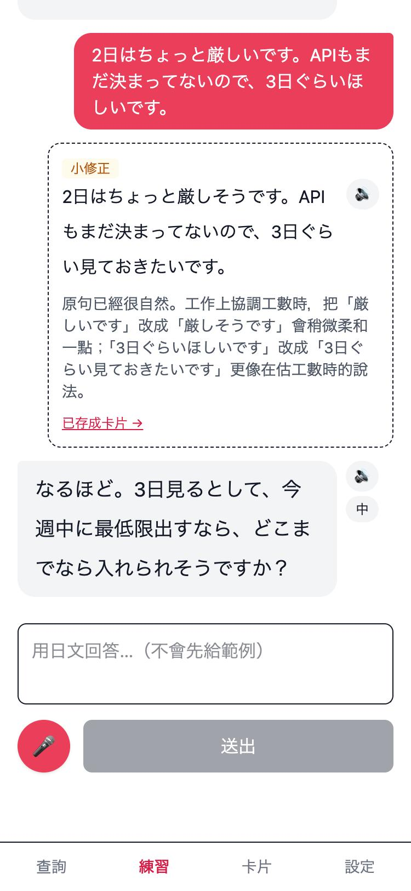<br><sub>修正、說明、存成卡片</sub></td>
  </tr>
</table>

Prompt 在 [worker/lib/practice.ts](worker/lib/practice.ts)，模型由 `wrangler.jsonc` 的 `OPENAI_MODEL_PRACTICE` 設定。

## 漢字讀音練習（讀音）

「練習 → 讀音」會產生一段短文，對話和新聞稿輪流出，場景是工作（會議、上線、規格）或東京生活。內容以 N1 程度設計，刻意放進容易唸錯的字（音讀訓讀、連濁、重複・相殺・早急這類特殊讀法）。

1. 不看假名先大聲唸一遍。可以錄下來回放，錄音只留在手機上。
2. 按「顯示讀音」：所有漢字詞標上假名、每句附中文翻譯，並列出容易唸錯的字（讀音、意思、為什麼容易唸錯）。
3. 在文中或清單點選唸錯的字，一鍵存成卡片（來源 `reading`，例句帶原文句子，重音查字典）。

最近的主題和字存在 D1，下一篇不會重複。不用語音轉文字評分，因為它回傳的是漢字，看不出你怎麼唸。

<table>
  <tr>
    <td align="center">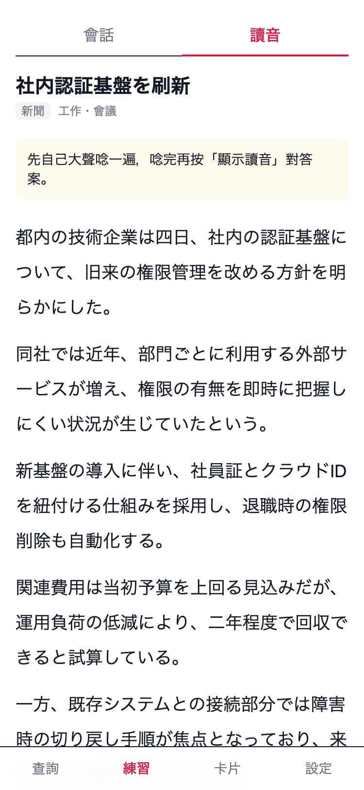<br><sub>先不看假名唸一遍</sub></td>
    <td align="center">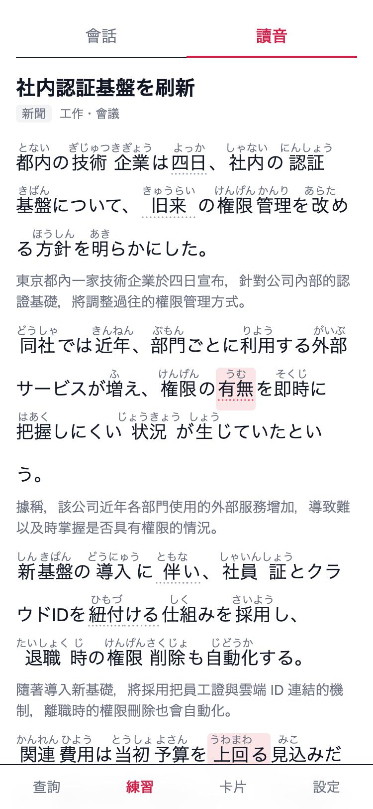<br><sub>顯示讀音，點選唸錯的字</sub></td>
  </tr>
</table>

## 架構

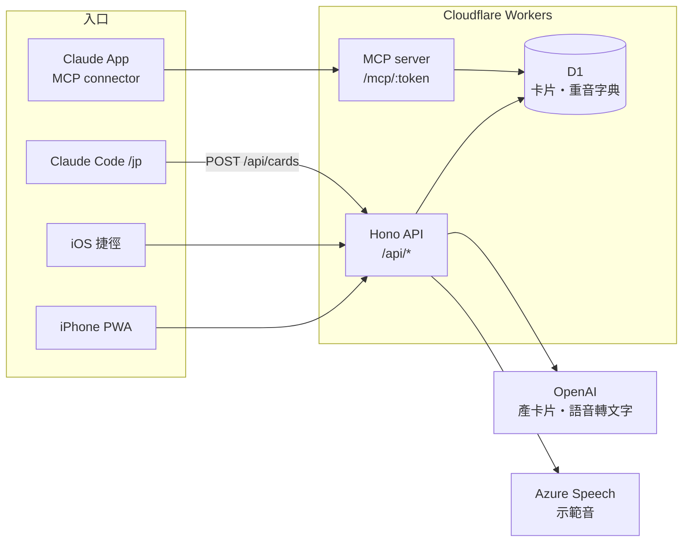

1. 收到請求後驗 token、檢查格式（[shared/schema.ts](shared/schema.ts) 前後端共用）
2. OpenAI 照固定格式回 JSON（[worker/lib/ai.ts](worker/lib/ai.ts)），App 用 SSE 邊收邊顯示
3. 伺服器拿卡片裡的單字去查重音字典（[worker/lib/accent.ts](worker/lib/accent.ts)），補上高低線
4. 存進 D1，回傳卡片；`/jp` 和 MCP 是已經寫好的卡片，直接從第 3 步開始

## 技術
- 前端：Vite + React + Tailwind，PWA（iPhone 可加入主畫面）
- 後端：Hono on Cloudflare Workers，D1（SQLite, Drizzle）、R2（音檔快取）
- AI：OpenAI API（三種模式各自的模型：`OPENAI_MODEL_LOOKUP`、`OPENAI_MODEL_ZH2JA`、`OPENAI_MODEL_NATURALIZE`，讀音練習用 `OPENAI_MODEL_READING`，在 `wrangler.jsonc` 改；`gpt-4o-transcribe` 語音轉文字）、Azure Speech（示範音）

> ChatGPT Plus / Pro 訂閱**不含** API 額度。API 要另外在 [platform.openai.com](https://platform.openai.com) 的 Billing 儲值，再到 API keys 建立 key。

## 本機開發

```bash
npm install
cp .dev.vars.example .dev.vars   # 填入各 API key 與自訂的 APP_TOKEN
npm run db:migrate:local
npm run dev
```

打開 http://localhost:5173 ，第一次會要你輸入 `APP_TOKEN`。

### 匯入重音字典
從 [Kanjium](https://github.com/mifunetoshiro/kanjium) 下載 `data/source_files/raw/accents.txt`，放到 `data/kanjium/accents.txt`（約 10.8 萬筆）：

```bash
curl -L -o data/kanjium/accents.txt https://raw.githubusercontent.com/mifunetoshiro/kanjium/master/data/source_files/raw/accents.txt
node scripts/import-accents.ts data/kanjium/accents.txt > data/kanjium/accents.sql
npx wrangler d1 execute nihongo-coach --local --file data/kanjium/accents.sql
```

沒匯入的話卡片仍可用，只是重音區會顯示「字典查無」。卡片詳情頁每次開啟都會重新查字典，所以匯入前建立的卡片也會補上重音。

重音資料來自 Kanjium，授權為 [CC BY-SA 4.0](https://creativecommons.org/licenses/by-sa/4.0/)，App 內已標示出處。

### Demo（mock 資料）

不用 API key 也能看畫面：用另一份本機資料庫，放入 [scripts/demo-cards.json](scripts/demo-cards.json) 的範例卡片。需要先照上一節下載重音字典，並在 `.dev.vars` 設好 `APP_TOKEN`。

```bash
npm run demo:setup          # 建 demo 資料庫並匯入重音字典
npm run demo                # http://localhost:5174
node scripts/seed-demo.ts   # 另開一個終端機，放入範例卡片
```

## 部署

```bash
cp .prod.vars.example .prod.vars             # 記下你的網址與 token（不會進 git）
npx wrangler login
npx wrangler d1 create nihongo-coach          # 把 database_id 貼進 wrangler.jsonc
npm run db:migrate:remote
npx wrangler d1 execute nihongo-coach --remote --file data/kanjium/accents.sql
npx wrangler secret put APP_TOKEN
npx wrangler secret put OPENAI_API_KEY
npx wrangler secret put AZURE_SPEECH_KEY
npm run deploy
```

> ⚠️ 遠端匯入重音字典大約會寫入 32 萬列（10.8 萬筆資料＋索引），超過免費方案每天 10 萬列的寫入上限。匯入本身會完成，但當天之後的寫入（存卡片）會被擋到隔天 00:00 UTC（日本時間 09:00）。只需要匯入一次；之後一般使用每張卡片只寫入幾列。

R2（示範音快取）是選用的：先在 Cloudflare 後台開通 R2，執行 `npx wrangler r2 bucket create nihongo-coach-audio`，再把 `wrangler.jsonc` 的 `r2_buckets` 取消註解後重新部署。

> 改了 `database_id` 之後本機會換成一份新的空資料庫，要重跑 `npm run db:migrate:local` 和重音匯入。

iPhone Safari 打開部署網址 → 分享 → 加入主畫面。接著照 [docs/ios-shortcuts.md](docs/ios-shortcuts.md) 設定捷徑。

## 電腦上用訂閱額度：`/jp` skill

在電腦上用 Claude Code 時，可以用訂閱額度產生卡片，不花 API 費用，卡片一樣存進 App、手機上看得到。

```bash
ln -s "$PWD/skills/jp" ~/.claude/skills/jp   # 安裝一次，所有專案都能用
```

在任何 Claude Code 對話裡：

```
/jp 說 可以幫我把後面打薄一點嗎 @在沙龍跟設計師說
/jp 改 この件について確認してから返事します @會議中回答部長
/jp 查 推し活
```

不加「查／說／改」時會自動判斷。skill 直接讀 `worker/lib/ai.ts` 的提示詞和 `shared/schema.ts` 的格式，跟 App 用同一份規則；網址和 token 從 `.prod.vars` 讀，token 不會印出來。

## 手機 Claude App：MCP connector

Worker 在 `/mcp/<MCP_TOKEN>` 提供一個 MCP server（Streamable HTTP，無狀態），有兩個工具：

- `save_card`：Claude 照 App 的規則寫好卡片後存進來，伺服器補重音（來源標為 `claude-app`）
- `list_cards`：讀最近存的卡片，可依分類或文字篩選

claude.ai 的自訂 connector 只能填網址，所以密鑰放在路徑裡；網址錯誤一律回 404。

設定（只要做一次）：
1. `npx wrangler secret put MCP_TOKEN`（完整網址記在 `.prod.vars` 的 `MCP_URL`）
2. 在 **claude.ai 網頁版** → 設定 → Connectors → Add custom connector，名稱填 `Nihongo Coach`，網址貼 `MCP_URL`。手機 App 不能新增 connector，但網頁加好後手機就能用。Team／Enterprise 方案只有 Owner 能新增自訂 connector。
3. 手機 Claude App 對話時直接說「日文怎麼說：……」「幫我改：……」「查：諸々」，Claude 會呼叫 `save_card`。

用 [MCP Inspector](https://github.com/modelcontextprotocol/inspector) 測試：

```bash
npx @modelcontextprotocol/inspector --cli "$MCP_URL" --transport http --method tools/list
```

## API

所有路由都要 `Authorization: Bearer <APP_TOKEN>`。

| 方法 | 路徑 | 說明 |
|---|---|---|
| POST | `/api/ask` | `{ mode, text, context?, source? }` → 卡片；`?format=text` 回純文字（給捷徑用）；`?stream=1` 用 SSE 串流 |
| GET | `/api/cards?category=&q=&cursor=&limit=` | 卡片列表，新的在前：`{ cards, nextCursor }`。把 `nextCursor` 當 `cursor` 帶回去拿下一頁（最後一頁為 `null`）；`limit` 預設 30、最多 100 |
| POST | `/api/cards` | `{ mode, input, source?, draft }` 直接存一張已寫好的卡片（不呼叫 AI，給 `/jp` skill 用）；同樣支援 `?format=text` |
| GET / DELETE | `/api/cards/:id` | 單張卡片 |
| GET | `/api/practice?limit=` | 最近的會話練習 |
| POST | `/api/practice` | `{ kind?: "work" \| "life" }` → 開始一題；SSE 串流，最後是 `session` 事件 |
| GET | `/api/practice/:id` | 單題與所有回合 |
| POST | `/api/practice/:id/turns` | `{ text }` → 修正與對方下一句；SSE 串流，最後是 `turn` 事件 |
| POST | `/api/practice/turns/:id/card` | 把該回合的修正存成卡片 |
| POST | `/api/transcribe` | multipart `audio` → `{ text }` |
| POST | `/api/tts` | `{ text }` → mp3 |
| GET / POST | `/api/reading` | 最近的讀音段落／`{ kind? }`（`conversation` 或 `news`，不填就輪流）→ 新段落 |
| GET | `/api/reading/:id` | 單一段落 |
| POST | `/api/reading/:id/cards` | `{ words }`（段落 `words` 的索引）→ 把唸錯的字存成卡片 |

## 下一步（Phase 2 / 3）
- 情境包（沙龍、看醫生…）與「出發前複習」
- SRS 開口複習（`cards` 已預留 FSRS 欄位）
- 錄自己念 → 音高曲線與示範音疊圖比對
- 會議即時聽寫（Mac 分頁音訊 / iPhone 麥克風）

## 授權

程式碼採用 [MIT License](LICENSE)。重音字典資料來自 [Kanjium](https://github.com/mifunetoshiro/kanjium)，授權為 CC BY-SA 4.0，不包含在本 repo 中，需自行下載。
